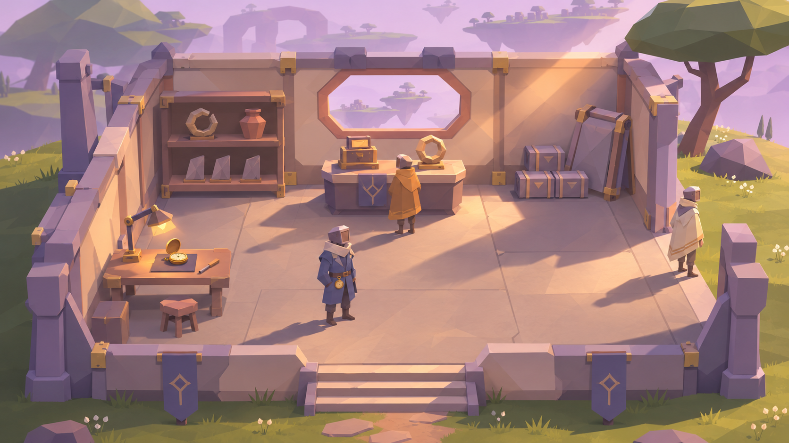

# 3D 风格基线 v0.1

建立日期：2026-11-13。用途：制作组共享的模型风格与 AI 建模约束。

来源为用户附件 `exec-1ee72d98-645f-4a9b-b5dc-debc8fe2afd9.png`，原始尺寸 1672×941。本包保留原文件，不裁切、不重绘、不插值。它是视觉参考，不是可测量的三维工程图。

## 一句话基调

**安静、质朴的幻想遗迹世界：清楚的低多边形切面，稳重的大体块，克制的装饰和低饱和材质本色。**

依据参考图整理的核心特征：柱墙厚实且有切角；家具结构简洁；器物采用多边形截面；人物由外套、斗篷和四肢的大块形体构成；树冠、石块都有大分面。画面中的紫色远雾、夕阳和长投影属于场景表现，不作为所有模型必须附带的颜色或几何。

## 共用造型语言

| 维度 | 执行基线 | 偏离表现 |
|---|---|---|
| 轮廓 | 主轮廓清晰；形体之间有明确主次；小物件可适度加厚以便识别 | 密集尖刺、细线、零碎挂件遮盖主要形体 |
| 分面 | 大平面有清楚转折；曲面以有限的多边形截面概括 | 随机碎三角、全身针状尖面，或整体过分光滑圆润 |
| 边缘 | 选择性切角、少量倒角；强度随物体大小保持一致 | 每条边都膨胀成圆胶囊，或依赖大量微小破损制造细节 |
| 表面 | 保留少量大尺度色差；材质差异优先通过本色与粗糙度表达 | 写实扫描纹理、毛孔、织物纤维、密集裂纹与划痕 |
| 装饰 | 少量宽条、几何扣件、菱形/分叉状符号，放在有用途的位置 | 每个面都加花纹、铭文、金边；把参考旗帜符号当成所有物件的统一徽标 |
| 旧物感 | 简化形体、局部缺角和温和色差 | 厚重污渍、全面锈蚀、恐怖废墟式损坏 |

“low-poly”指可见的造型语言，不能靠无差别减面获得。大平面可以保持连续；弯折处的法线需服务于设计。动画关节允许必要的支撑拓扑，外观细节密度仍保持一致。

## 各类模型的基调

| 类别 | 形体与结构 | 材质和细节 | 首轮工作默认值／边界 |
|---|---|---|---|
| 角色 | 小而简化的头部、清楚四肢、长外套或斗篷的大剪影；衣领、腰带、鞋靴概括成块 | 布料主色明确；少量大衣褶；五官稀疏、头发成束或成块 | 成人角色暂用约 6–7 头身，属建议范围，待角色样板确认；不要把参考图简化的头部默认解释为机器人 |
| 墙柱与门窗 | 厚墙、方柱、柱帽、宽窗框；大开口有清楚边框和壁厚 | 石面少量低频色差，木梁和少量金属连接件 | 可拼接模块保持截面一致；场景剖切、缺顶和八边形窗是本图构图/设计，不要求每栋建筑照搬 |
| 地板与台阶 | 大块板面、浅接缝、宽踏面、清楚外沿 | 轻微面色差；少量裂缝即可 | 板块尺寸配合实际关卡；不按图片透视反推精确尺寸 |
| 家具与储物 | 厚桌板、结实桌腿、少量层板、明确柜体；箱盖和箱体层次清楚 | 木色为主，少量金属包角与带条 | 可开合箱盖、柜门单独成件；静态装饰可合并合理部件 |
| 小道具与遗物 | 夸张一点的功能轮廓；壶腹、台灯、怀表、环形遗物以块面概括 | 金属/陶土/木材各自清楚；每件保留一个主要识别点 | 圆形截面可从 6–12 边试起，按屏幕尺寸调整；这是造型建议，不是统一网格预算 |
| 树木 | 不规则大块树冠、简化分叉、带切面的树干 | 灰橄榄绿与少量黄绿叶团；木干低细节 | 叶团体积清楚，避免单叶堆叠或把树冠统一做成规则球体 |
| 草花 | 少量宽叶片构成一簇，小花是简化色点和几何花头 | 与树冠同色系，花色少量点缀 | 保持簇状节奏，不强制逐根草叶或每片叶子实体化 |
| 岩石与地形 | 不规则大体块、有限的大切面、清楚上表面与侧壁 | 灰紫/灰褐石色、低频面色差 | 悬浮岛属于关卡设计选项；不附加到普通石块或道具底座 |
| 布旗与软装 | 明确的布面外形、少量宽折面、简洁下摆 | 靛蓝、米白、赭黄等单一主色与小面积标记 | 需要布料运动时交给对应技术方案；静态参考不证明已绑定/可模拟 |

本图没有独立展示的类别（例如怪物、载具）继承共用造型语言，具体造型另定；不要仅凭风格包发明世界观硬规则。

## 固有色：工作色板

下列 sRGB 十六进制颜色是人工整理的**首轮工作色板**，用于表达相对关系；它们不是从光照中精确还原的原图 albedo，也不是用户已经逐个确认的最终色值。在统一白光下看样板后再收敛。输入材质颜色时留意软件的 sRGB/线性空间转换。

| 用途 | 工作色值 | 使用方式 |
|---|---|---|
| 暖米石 | `#B9AD98` | 墙面、地板的基础色 |
| 灰紫石 | `#827D8B` | 柱、岩石或次级石材；不作为统一阴影色 |
| 灰褐木 | `#806454` | 家具、木梁 |
| 陶土 | `#A36D56` | 壶罐、陶器 |
| 靛蓝布 | `#555E7A` | 角色衣服、旗帜 |
| 赭黄布 | `#B48A45` | 角色变化和小面积强调 |
| 暖米白 | `#D2C5A9` | 衣领、围巾、浅色服装 |
| 旧黄铜 | `#B69757` | 扣件、器物、包角；高光由材质计算 |
| 灰橄榄绿 | `#7F8654` | 树冠和植被主色 |
| 黄绿 | `#A5A26A` | 少量植被变化 |

每件资产优先采用 1 个主色、1–2 个辅助色和少量强调色，这是复杂度控制建议。角色配色可变，石材不必全紫，普通木桌不必镶金。

## 材质与光照的分工

美术资产负责形体、法线、UV、材质分区、固有色和粗糙度关系。场景端负责阳光方向、天空填充、接触与投射阴影、雾和最终画面调色。图中光感可在 UE 中朝同一方向制作；单张图片不能唯一确定原始灯光参数，也不保证像素级复现。

- 石、布、木主要呈哑光；陶器略有材质反差；旧黄铜保留柔和金属反射。不要为了“低多边形”把全部材质设成同样的塑料或无光材质。
- Base Color 中不烘焙夕阳色带、窗框投影、亮侧/暗侧和镜面亮点。允许少量不依赖光源方向的材质色差、纹样和表面磨损。
- 需要 AO 时单独保存并让引擎控制强度，避免黑边和重复遮蔽。用于形成轮廓的切面应由几何与法线支撑，不靠画假的三角形阴影代替。
- 复核时使用统一中性白光、固定曝光与一致背景；最终游戏灯光另行制作。这是比较材质的方法，不是对游戏光感的限制。

工程依据：[Epic 材质文档](https://dev.epicgames.com/documentation/en-us/unreal-engine/physically-based-materials-in-unreal-engine)说明 Base Color、Roughness 和 Metallic 的职责；[Epic 环境光文档](https://dev.epicgames.com/documentation/unreal-engine/environmental-light-with-fog-clouds-sky-and-atmosphere-in-unreal-engine)说明灯光、天空和雾组件。以上视觉选择是本项目的工作规范。

## 首轮样板与判定

建议优先使用“人物、墙柱、木柜、树石”作为覆盖不同类别的样板；本包尚未生成或验收这些模型。检查大轮廓是否统一、切面尺度是否相近、材质细节是否同一量级、在换光后颜色是否仍自然。发现偏差时明确改哪个部位，例如“树冠减少小叶团，合并成三个不规则主块”，而非只说“再像参考图一点”。
