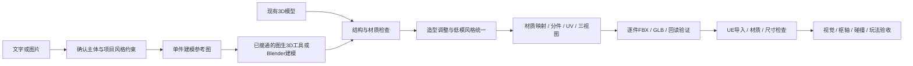

# 从输入到 UE 的工作流

版本 v0.2.0。风格基线保持 v0.1，流程新增自动化执行。“一键”表示助手在授权范围内连贯执行，能力边界以实际工具和检查结果为准。



## 1. 分辨输入和实际产物

| 输入 | 处理方式 | 必要证据 |
|---|---|---|
| 一句话需求 | 写资产说明、部件与配色，选择简单程序建模或生成服务 | 实际网格文件及渲染 |
| 参考图片 | 看清主体，用共用风格生成单件参考；补充未知背面设计 | 保存原图、统一后的参考图与推断记录 |
| 已有模型 | 读尺寸、层级、纹理、材质和拓扑；保留源模型 | 修改前后真实网格和同视角对比 |
| 多视图 | 先检查视图是否互相一致；按同一比例建模 | 不用独立生成的矛盾视图冒充精确三视图 |

场景图只作风格参考。图生 3D 采用完整、无遮挡的单件图；服务支持多视图时再提供对应视图。无足够依据时不从透视图推算精确尺寸。

## 2. 风格转换

继承 [风格基线](style-baseline.md)。固定：主要用途、识别轮廓、必须保留的部件、相对位置。可调整：细碎表面、截面边数、切角、装饰密度、色板与材质。若用户要求严格保形，保持外轮廓并用对比图验证。

图片转换的补充提示词：

```text
Use the subject image for object identity and functional structure, and the project reference for style only. Preserve the main silhouette, essential components and their relative placement. Simplify the object into substantial primary volumes, broad planar facets and selective chamfers. Reduce microdetail while retaining the features that identify its function. Apply the project's muted material-local palette, matte painted/wood/stone/cloth surfaces as appropriate, and restrained rough metal on real metal fittings. Show one complete isolated asset under neutral white illumination. Keep base colors free of painted directional shadows or specular highlights. Do not add the reference scene, its floating islands, banners or unrelated decorative bases.
```

有实际模型时先判断是否需要重建轮廓。脚本的 `project` 模式只能做平面着色与材质统一，`decimate_ratio` 只能减少拓扑；二者都不能把写实繁复的造型自动设计成目标风格。对大体块不符的模型，先由建模工具或 Blender 脚本调整形状，再进入整理阶段。

## 3. 获得真实模型

- 简单道具/建筑：助手可编写 Blender 配方，按分件、截面、尺寸构建网格。保存源脚本以便改参数和重做。咱们的电脑、台灯已验证这一路径。
- 复杂物体：优先使用实际接通的图生 3D 服务；使用前读取该服务当前文档与可用模型。记录任务 ID，等待同一任务结果，下载真实文件后才进入下一步。首次提交成功后发生轮询超时，应继续查询同一任务，避免重复计费。
- 已有模型：无需重新生成，先完成必要的风格改造与结构修复。
- 人物/变形物体：单独处理关节拓扑、UV、绑定、动作与 UE 骨架约定。当前静态整理脚本会拒绝骨架、动画和形态键，不能用降面替代这一步。

没有生成工具时，简单物体可以使用已授权的本地 Blender 建模。复杂物体无法制作时交付已经完成的参考图与结构说明，并明确缺少的建模能力，不能把参考图命名为模型。

## 4. 整理、复核与交接

按 [运行说明](running-pipeline.md) 执行。生成三视图后实际查看，不因数字通过就自动认可风格。比较轮廓、比例、切面大小、色板、功能结构和遮挡。发现偏差就修改原建模配方或任务参数，输出新版本。

技术检查失败时修复原因后重跑；相同问题连续两次仍失败，应换处理方法或说明阻碍，不能无限重试。外部服务错误使用其错误语义判断是否可重试。

状态记录必须对应证据：

| 状态 | 证据 |
|---|---|
| 风格参考已制作 | 实际图片；保形要求另外复核 |
| 模型已制作 | 实际网格可读取 |
| 本地导出检查通过 | `asset-manifest.json` 中 `export_roundtrip=passed` |
| 视觉复核完成 | 已查看三视图，记录偏差和补充设计 |
| UE 导入与尺寸材质检查通过 | `ue-import-report.json` 的对应结果 |
| UE 可用于当前玩法 | 另有枢轴、碰撞、方向、装配和实际玩法验证记录 |

当前服务的宣传或模型名不能替代任何验收步骤。完整交付同时包含所用工具/版本、模型格式、贴图或常量材质方案、三视图、来源和仍需处理的问题。
